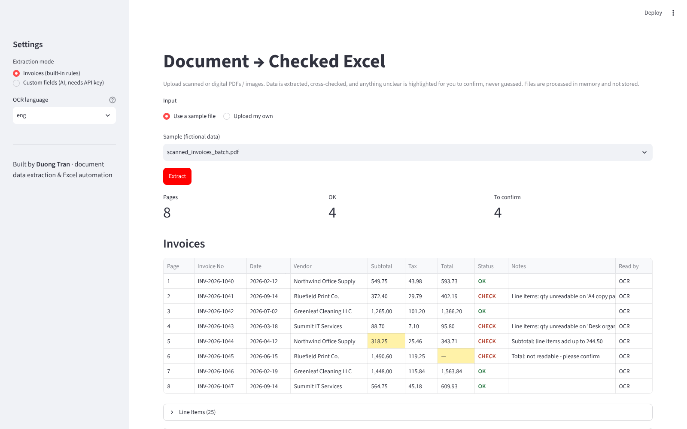

# Document → Checked Excel (Streamlit demo)

**Live demo: https://duong-doc-to-excel.streamlit.app**



Upload scanned or digital PDFs / images → OCR (scanned pages only) → extraction → cross-checks → Excel download.

- **Invoices mode** (no API key): invoice no, date, vendor, subtotal, tax, total, line items. Checks line items vs subtotal, subtotal + tax vs total, unreadable values.
- **Custom fields mode** (optional, hidden in the public demo; enable with env `ENABLE_AI=1` + an Anthropic API key): every value must come with an exact quote from the page; unverified values are highlighted.
- Digital PDFs use the text layer (exact); scanned pages fall back to Tesseract OCR (eng / vie).
- Sample files in `samples/` are fictional.

## Run locally
```
sudo apt install tesseract-ocr tesseract-ocr-vie poppler-utils   # Windows: install Tesseract + Poppler and add to PATH
pip install -r requirements.txt
streamlit run app.py
```

## Deploy free on Streamlit Community Cloud
1. Push this folder to a public GitHub repo (`requirements.txt` and `packages.txt` at the repo root).
2. share.streamlit.io → Create app → pick the repo, main file `app.py` → Deploy.
3. Put the app link in your Upwork profile and proposals.
